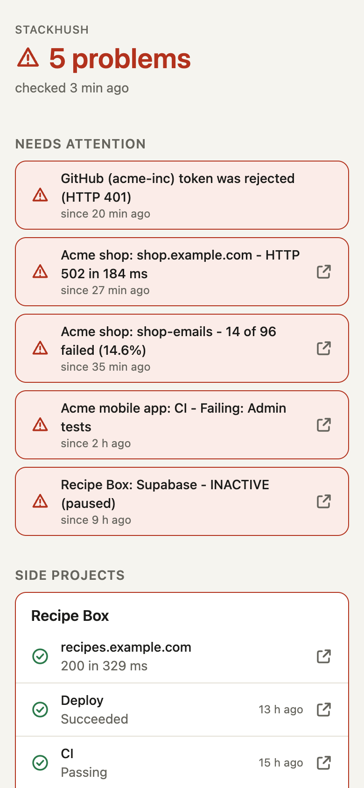
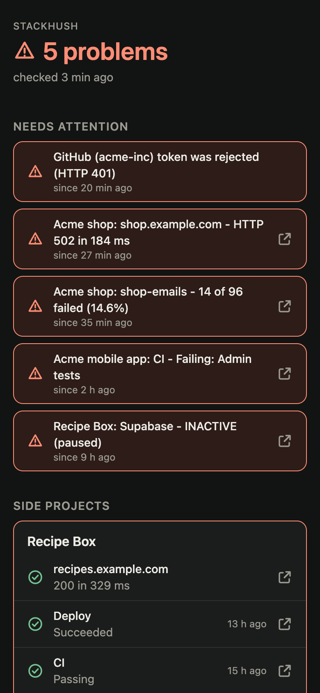
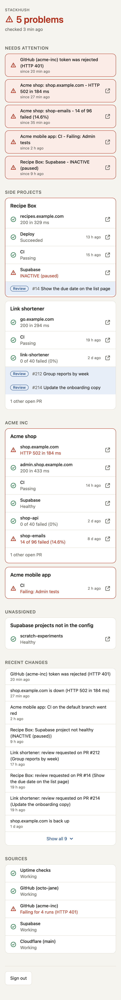
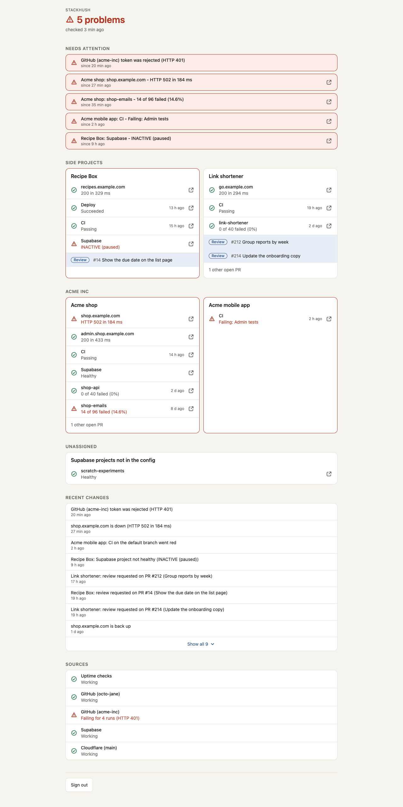
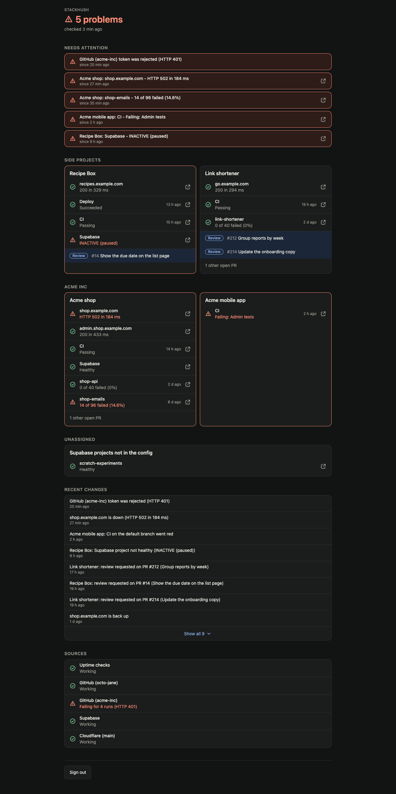

# stackhush

Quiet your stack. One private dashboard for your projects' uptime, CI, deploys, PR reviews,
database health and Worker errors, and one email only when something changes. Runs free on
Cloudflare with read-only keys.

<p>
  
  
</p>

<details>
<summary>The whole page on a phone</summary>



</details>





The screenshots show made-up projects from the example config (`npm run screenshots` regenerates
them from `npm run seed:local`, with placeholder tokens so every source counts as set; no API is
called).

## What it watches

| Source               | What you see                                                                                            | Needs                                                 |
| -------------------- | ------------------------------------------------------------------------------------------------------- | ----------------------------------------------------- |
| Uptime               | Each production URL: status code and latency. Down after two failed checks in a row.                    | Nothing                                               |
| GitHub Actions       | Whether CI on a repo's main branch is passing, and which workflow fails.                                | GitHub token, Actions: read                           |
| GitHub Deployments   | Whether the last deploy to each environment succeeded (for hosts such as Vercel that report to GitHub). | GitHub token, Deployments: read                       |
| GitHub pull requests | Open PRs, and the ones that are waiting for your review.                                                | GitHub token, Pull requests: read                     |
| Supabase             | Whether each project is healthy or paused.                                                              | Supabase token, Projects (account-wide): Read         |
| Cloudflare Workers   | Error rate of each Worker over the last 30 minutes.                                                     | Cloudflare token, Analytics and Workers Scripts: read |

A cron job runs every five minutes. It compares what it sees with what it saw last time and sends
one email, only when something changed: a site went down or came back, CI went red or green, a
deploy failed, a Supabase project paused, a Worker crossed the error threshold, a review was
requested of you (once per PR). The first run records the current state without sending anything,
so you are not flooded on day one.

Every source is optional. Without its token a source shows as "not configured" on the dashboard
and is neither checked nor counted as failing. Checks it stored earlier are kept and hidden until
the token is back.

## What it does not do

- It does not read logs, traces or metrics beyond the above, and it is not a replacement for a
  monitoring product. It tells you that something changed, not why.
- No Vercel, Railway, Dependabot or cost tracking. Vercel deploys are seen through GitHub
  Deployments, not through a Vercel token (see the security model).
- No write access anywhere: it never triggers a deploy, re-runs a workflow or changes a setting.
- One owner. There are no user accounts, teams or roles. Alerts go to one address.
- Email is the only alert channel in this release.

## Quick start

You need a Cloudflare account with a domain on it (for the dashboard and for sending email), Node
24 and, depending on what you watch, a GitHub, Supabase and Cloudflare token.

```bash
git clone https://github.com/coen593/stackhush.git
cd stackhush
npm ci
cp stackhush.config.example.ts stackhush.config.ts   # then edit it
```

`npm ci` prints `npm warn install-scripts` lines for esbuild, workerd and fsevents; they are
expected.

Try it locally first, with synthetic data and no tokens:

```bash
npm run db:migrate:local
npm run seed:local
npm run dev                  # http://localhost:5173
npm run signin-link:local    # open the printed link
```

Without tokens, the local dashboard lists the GitHub, Supabase and Cloudflare sources as "not
configured" and hides their checks, so a project with only a repo has no card. Recent changes
still lists the seeded events for them. `npm run screenshots` shows the configured view: it starts
the dev server with placeholder tokens, which are never sent anywhere.

If port 5173 is taken, see [Local development](docs/setup.md#local-development).

Then follow [docs/setup.md](docs/setup.md): `wrangler login` and the placeholders in
`wrangler.jsonc`, domain on Cloudflare, Email Sending on a subdomain, a verified destination, the
D1 database, `npm run deploy`, secrets, sign-in. Every config field is explained in
[docs/configuration.md](docs/configuration.md).

## Security model

- **Read-only keys everywhere.** Each token is created with the shortest list of read permissions
  that works (the exact lists are in [docs/setup.md](docs/setup.md)). A leaked token can read
  what those permissions cover (CI logs, pull requests, Worker code), but cannot change anything.
- **No Vercel token.** Vercel tokens can be scoped to an account, a team or one project, but not
  limited to read access: even a project token can change and delete that project's deployments
  and settings. stackhush asks GitHub instead, which already receives deployment status from
  Vercel through the Deployments API.
- **Owner-only access.** Everything under `/api/*` except sign-in needs a session cookie
  (`__Host-` prefix, HttpOnly, Secure, SameSite=Lax). Sessions and sign-in codes are stored as
  SHA-256 hashes only.
- **Email sign-in.** The sign-in page sends a short code and a link to the alert address through a
  Cloudflare email binding that is pinned to that one destination, so the Worker cannot mail anyone
  else. The code only works in the browser that asked for it, is capped at five wrong tries, and
  sends are capped at 5 an hour and 20 a day. Sign-in links point at the configured
  `dashboardUrl`, never at the request's Host header. A terminal fallback (`npm run signin-link`)
  prints a one-time link whose code sits in the URL fragment, so it never reaches a server or log.
- **Nothing private in the static bundle.** The browser bundle contains only the dashboard code.
  Project names, repos, URLs and group names come from `/api/status` after sign-in, never from the
  config. ESLint forbids importing the config or `worker/` from `src/`.
- **Secrets stay out of files.** Tokens are Worker secrets you type into wrangler; the config and
  `wrangler.jsonc` hold none. State-changing requests must be same-origin JSON, and responses
  carry the usual security headers.

To report a vulnerability, see [SECURITY.md](SECURITY.md).

## Limits

- Every check runs every five minutes, and the Workers Free plan allows 50 subrequests per run.
  A config that needs more than `subrequestBudget` (default 45) is refused with the number it
  needs: roughly one per site and repo, six per GitHub token, one for Supabase, two per Cloudflare
  account. Bigger setups need Workers Paid and a higher `subrequestBudget`. Spreading checks over
  several runs is not in this version; it may come later.
- A workflow deleted while it was failing can stay red, a removed Vercel project can keep its
  Deploy row red, and a few other edge cases. See [docs/limits.md](docs/limits.md).
- Checks run every five minutes, so an outage is noticed within roughly ten (two failed checks).

## Roadmap

- Next: a PWA with in-page and push notifications, so alerts do not depend on email alone.
- Later: webhooks for Slack, Discord and ntfy.

## Contributing

See [CONTRIBUTING.md](CONTRIBUTING.md). Changes are listed in [CHANGELOG.md](CHANGELOG.md).

## Licence

MIT, see [LICENSE](LICENSE).
